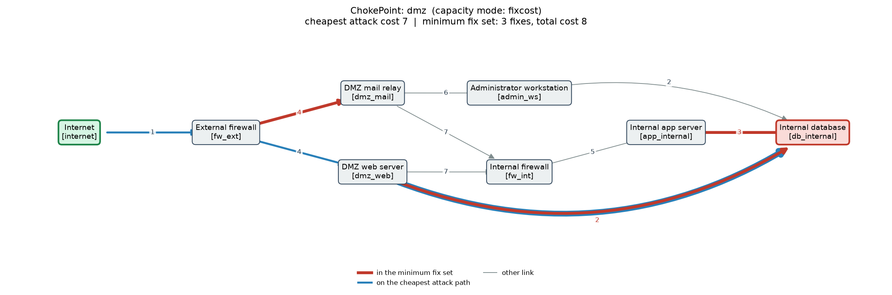
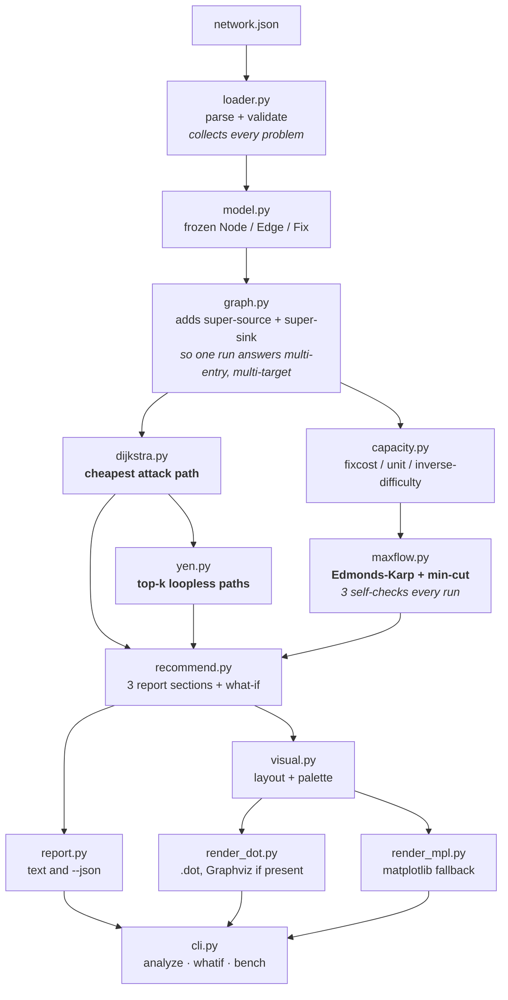

# ChokePoint

**Attack-path and patch-priority analyzer**

> Status: complete and tested. 2,804 tests pass; every number below is produced by a script in this repository.

A network is a directed graph. An attacker moving through it is a path. The
cheapest set of fixes that stops every attacker is, exactly and not
metaphorically, a **minimum cut**.

ChokePoint models a network as a graph where edge weights are how hard a step
is for an attacker and edge capacities are how expensive that link is for a
defender to close, then answers two questions:

1. **How would an attacker reach the crown jewels most cheaply?**
   Dijkstra for the cheapest route, Yen's algorithm for the next-best ones.
2. **Which smallest set of fixes cuts off every route?**
   Edmonds-Karp max-flow, with the cut read off the residual graph.

Dijkstra, Yen's k-shortest loopless paths, Edmonds-Karp, min-cut extraction
and the what-if analysis are all written by hand against the standard
library. `networkx` appears only in the test suite, as an independent oracle
to disagree with them.

---

## Quickstart

From a clean clone:

```bash
git clone https://github.com/Kunal0626/chokepoint.git && cd chokepoint
```

```bash
python3 -m venv .venv && .venv/bin/python -m pip install -e ".[dev]"
```

```bash
.venv/bin/python -m pytest
```

```bash
.venv/bin/chokepoint analyze examples/dmz.json --k 3
```

Developed and tested on **CPython 3.14.6**. The declared floor is 3.11 and
every source file has been checked to parse under it, but the project has not
been *run* on 3.11, so treat that as a syntax claim rather than a support
claim.

## What it produces

`examples/dmz.json` models a textbook perimeter — internet, external
firewall, DMZ, internal firewall, internal network — with one deliberate
mistake: a temporary DMZ-to-database firewall rule from a data migration that
nobody removed.

```
1. ATTACK PATHS                                                cheapest: 7
--------------------------------------------------------------------------

   Cheapest route, hop by hop:

      Internet [internet]
        |  difficulty 1   send traffic to published services
        v
      External firewall [fw_ext]
        |  difficulty 4   unpatched web application
        v
      DMZ web server [dmz_web]
        |  difficulty 2   legacy firewall rule left open after a migration
        |  fix: Remove the legacy DMZ-to-database firewall rule (cost 1)
        v
      Internal database [db_internal]   <-- TARGET

   Top 3 distinct loopless paths:

      #1  difficulty   7   Internet -> External firewall -> DMZ web server -> Internal database
      #2  difficulty  13   Internet -> External firewall -> DMZ mail relay -> Administrator workstation -> Internal database
      #3  difficulty  20   Internet -> External firewall -> DMZ web server -> Internal firewall -> Internal app server -> Internal database

2. MINIMUM FIX SET (min-cut)                                 total cost: 8
--------------------------------------------------------------------------

      cost   4   Mail filtering and DMARC enforcement
      cost   3   Least-privilege database account for the application
      cost   1   Remove the legacy DMZ-to-database firewall rule
      --------
      total  8
```

**It finds the shortcut.** Path #1 uses the leftover rule and costs the
attacker **7**. Path #3 is the same attacker going the way the architecture
intended, through the internal firewall, at **20**. One forgotten rule makes
the network roughly three times easier to attack than its design implies.

Ask what happens if you delete just that rule:

```bash
.venv/bin/chokepoint whatif examples/dmz.json --apply "Remove the legacy DMZ-to-database firewall rule"
```

```
   Cheapest attack cost before : 7
   Cheapest attack cost after  : 13
   Raised the attacker's cost by : +6
```

A fix costing **1**, measured in minutes, buys **+6**. It does not restore the
20, because the administrator-phishing route at 13 is now the cheapest — which
is how this work actually goes.

Every run also writes a `.dot` file and a picture, with cut edges red, the
cheapest path blue, and entry points and targets visually distinct:

```bash
.venv/bin/chokepoint analyze examples/dmz.json --out ./artifacts
```



The long curve sweeping under the internal firewall is the legacy rule.

## Architecture



The super-source and super-sink are the load-bearing design decision. A model
can have several entry points and several targets, but shortest-path and
max-flow are both defined for one source and one sink. Doing that stitching
once, in `graph.py`, means the three algorithms never special-case it — and
for the min-cut it is not merely convenient: the union of per-pair minimum
cuts is **not** a minimum cut of the whole problem, so the obvious alternative
would recommend more fixes than are actually needed.

## Measured results

Measured on **Apple Silicon (arm64), macOS 26.6.2, CPython 3.14.6**, median of
5 runs after one untimed warm-up, on seeded layered graphs with 5 edges per
node. Reproduce with `.venv/bin/python -m chokepoint bench` and
`.venv/bin/python scripts/benchmark_sweep.py`.

### 1,000 nodes, 5,000 edges

| operation | median | min | max |
|---|---|---|---|
| build augmented graph | 1.84 ms | 1.83 ms | 1.95 ms |
| Dijkstra | 1.11 ms | 1.05 ms | 1.13 ms |
| Yen k=3 | 22.18 ms | 22.13 ms | 22.23 ms |
| Edmonds-Karp + min-cut *(including self-checks)* | 132.56 ms | 130.94 ms | 133.23 ms |

The complete analysis of a 1,000-node network takes **under 160 ms**. That run
found a 20-hop cheapest path and a 122-edge minimum cut, so it was not
measuring a degenerate graph.

### Scaling, 100 → 2,000 nodes

| operation | empirical | theoretical bound |
|---|---|---|
| Dijkstra | n^1.03 | O((V + E) log V) |
| Yen k=3 | n^1.50 | O(k · V · (V + E) log V) |
| Edmonds-Karp + min-cut | n^1.56 | O(V · E²) |

Edmonds-Karp beating its own bound by that much is explained, not celebrated:
the augmentation count tracks the max-flow value rather than the O(V·E) worst
case, and on these graphs the cut grows as n^0.52, so n^0.52 augmentations
times a linear BFS predicts n^1.52 against n^1.56 measured. That n^0.52 is a
property of the generator's shape, not of the algorithm.
[docs/BENCHMARKS.md](docs/BENCHMARKS.md) has the full tables and the caveats.

### Correctness

| | |
|---|---|
| Tests | **2,804**, passing in 4.4 s |
| Oracle comparisons against `networkx` | 1,500 on seeded random graphs (shortest path, top-k cost sequence, min-cut across all three capacity modes) |
| Self-checks inside the program | 3, on every invocation, raising rather than asserting |
| Example output reproducibility | enforced by a test that fails if committed output drifts |

## Command line

```
chokepoint analyze <file> [--k N] [--capacity MODE] [--json] [--out DIR]
chokepoint whatif  <file> --apply "fix name" [--k N] [--capacity MODE] [--json]
chokepoint bench   [--nodes N] [--edges N] [--seed N] [--repeat N] [--json]
```

`--capacity` selects what the minimum cut minimises: `fixcost` (default, the
cheapest adequate set of fixes), `unit` (the fewest links, which by Menger's
theorem equals the maximum number of edge-disjoint attack paths), or
`inverse-difficulty`.

Exit codes: **0** success, **2** bad input or request, **3** an internal
self-check failed and the output should not be trusted. The last is kept
separate on purpose — collapsing it into 2 would let a real bug look like a
user error.

## Repository layout

```
src/chokepoint/
  loader.py     JSON parsing and validation; reports every problem at once
  model.py      frozen Node / Edge / Fix / Network
  graph.py      super-source and super-sink; arcs keep edge identity
  dijkstra.py   by hand, heapq, with the ban-sets Yen needs
  yen.py        by hand, k shortest loopless paths
  capacity.py   the three capacity modes, exact arithmetic
  maxflow.py    by hand, Edmonds-Karp, min-cut extraction, self-checks
  recommend.py  the three report sections and the what-if analysis
  report.py     text and JSON rendering
  visual.py     layered layout and palette, shared by both renderers
  render_dot.py DOT output, and Graphviz if it is installed
  render_mpl.py matplotlib fallback
  bench.py      seeded layered graph generator and timing harness
  cli.py        analyze / whatif / bench

examples/       three hand-made networks, their notes, and committed output
docs/           the maths, the design arguments, the measurements
scripts/        regenerate every number quoted anywhere in this repository
tests/          2,804 tests
```

## Documentation

| | |
|---|---|
| [docs/MAXFLOW_MINCUT.md](docs/MAXFLOW_MINCUT.md) | Why the min-cut is the right answer, a worked 5-node example, why Edmonds-Karp over Ford-Fulkerson, what residual edges are for |
| [docs/MINCUT_VS_GREEDY.md](docs/MINCUT_VS_GREEDY.md) | Why the minimum fix set and the single-fix ranking disagree, with an example where they give opposite advice and both are right |
| [docs/BENCHMARKS.md](docs/BENCHMARKS.md) | Every measurement, the environment, and what is not being timed |
| [docs/INTERVIEW_NOTES.md](docs/INTERVIEW_NOTES.md) | Each design decision, the alternatives, and the 15 hardest questions with answers |
| [examples/README.md](examples/README.md) | The difficulty and fix-cost rubric, and what those numbers are not |

## Limitations and future work

Stated plainly, because the output looks more authoritative than it is.

**The numbers are judgement, not measurement.** Difficulty and fix cost are
entered by a human with opinions. Two analysts would produce two different
graphs for one network. What the tool adds is that the assumptions become
explicit and their consequences computable — you can change a 3 to a 4 and see
whether the recommendation moves.

**Fixes are treated as independent, and real defences are not.** Several edges
may share a fix name, and the report de-duplicates when totalling, but the
min-cut search itself still prices each edge separately. So when fixes are
shared, the cut that minimises the capacity is not necessarily the one that
minimises the real bill. ChokePoint reports a cut that is provably optimal for
the capacity objective and tells you its true de-duplicated price; it does not
claim that price is optimal. Optimising it directly is no longer a min-cut
problem.

**Additive difficulty is not how attackers work.** Summing assumes effort
accumulates independently, when credentials harvested at hop 2 can make hop 5
trivial.

**One attacker, one skill level.** A difficulty of 8 means something different
to a bored teenager and a funded team.

**Only edges can be cut.** Removing a *host* is a node cut, which needs node
splitting — replace each node with an in/out pair joined by an edge priced at
the cost of removing it. Not implemented.

**Probabilities instead of additive difficulty** would work for path-finding
(take `-log p` and Dijkstra is unchanged) but **not** for the min-cut, because
max-flow needs capacities that add in parallel and probabilities do not. That
is a genuinely harder problem, related to network reliability.

**`--capacity inverse-difficulty` does not mean what its name suggests.**
Where the cut has a choice along a route it severs the *hard* link, since
1/10 is cheaper than 1/1. It is coherent under a bottleneck reading but is not
"go and fix the easy things". [capacity.py](src/chokepoint/capacity.py) spells
this out.

**Not verified on Python 3.11** despite the declared floor; see Quickstart.

**No incremental re-analysis.** Every what-if rebuilds and re-runs from
scratch. Fine at these sizes, wasteful at much larger ones.

---

Part of my portfolio: [github.com/Kunal0626](https://github.com/Kunal0626)
